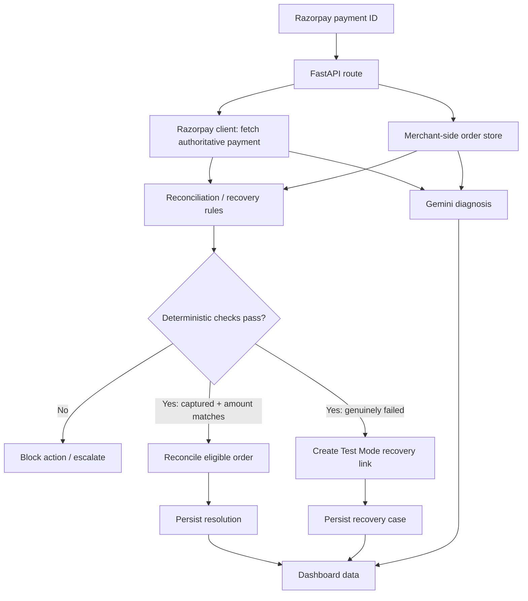

# Architecture Notes

This document describes the intended separation of responsibilities in the AI Revenue Resolution Agent. It is based on the FastAPI implementation shared during development; compare it with the current source before changing module boundaries.

## High-level flow

## Components

| Component | Responsibility |
|---|---|
| `app/main.py` | FastAPI application, HTTP routes, orchestration of use cases, and dashboard response |
| `app/razorpay_client.py` | Razorpay SDK client and Payment Link creation |
| `app/database.py` | Merchant-side order records, recovery cases, dashboard aggregation, and resolution records |
| `app/ai_agent.py` | Gemini-backed diagnosis of payment/order state |
| `app/reconciliation.py` | Deterministic reconciliation decision for payment/order state |
| `app/recovery.py` | Recovery eligibility and action decision |

The exact persistence engine, environment-variable names, and schema should be confirmed from the current files before documenting them more specifically.

## Critical decision boundary

The application should separate:

1. **Evidence collection:** fetch the payment from Razorpay and retrieve the local merchant-order record.
2. **Explanation:** ask Gemini to explain the observed state difference in natural language.
3. **Authorization of side effects:** use deterministic application rules—not an LLM-generated statement—to decide whether an order may be reconciled or a recovery link may be created.

At minimum, reconciliation should require an authoritative captured status, a matching order association, and an exact amount match in the same currency/unit. If a required field is missing or inconsistent, the safe result is no automatic action and an escalation/review state.

## Dashboard data flow

The dashboard is served by the FastAPI application at `/dashboard`. Its JavaScript requests `/dashboard-data` and renders summary values and case/activity sections. The KPI labels visible in the UI include revenue at risk, revenue recovered, resolved cases, and escalated cases.

## Important design gaps to address before production

- Protect all mutating routes with authentication and authorization.
- Remove, disable, or tightly gate `/test/*` and `/debug/*` routes in production.
- Use idempotency keys and database constraints to prevent duplicate recovery-link creation and duplicate resolution records.
- Associate a recovery completion with the exact `recovery_link_id` and original failed payment/order, rather than choosing a generic open recovery case.
- Validate payment status, amount, currency, and order association server-side before every financial state update.
- Persist an auditable reason for every automatic action, blocked action, and escalation.
- Handle Razorpay API timeouts, retries, and rate limits without repeating unsafe side effects.
- Add unit and integration tests, including mismatch and duplicate-request cases.
